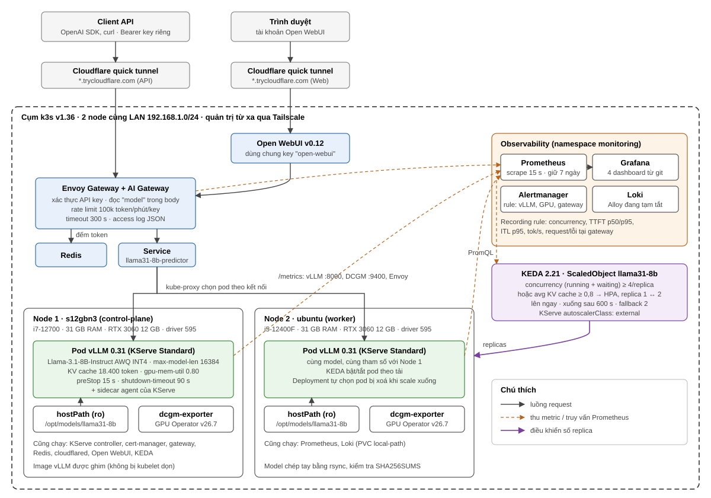
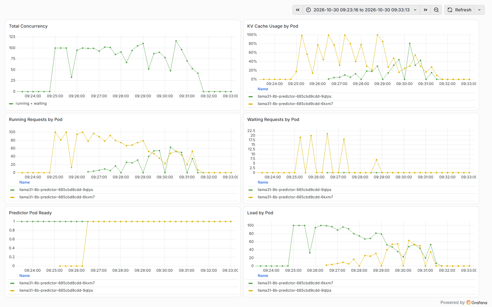
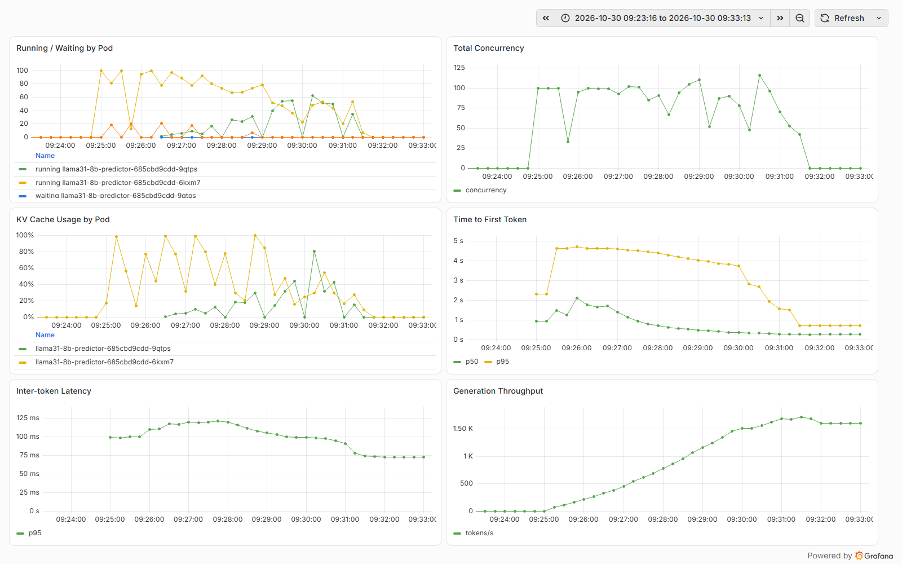
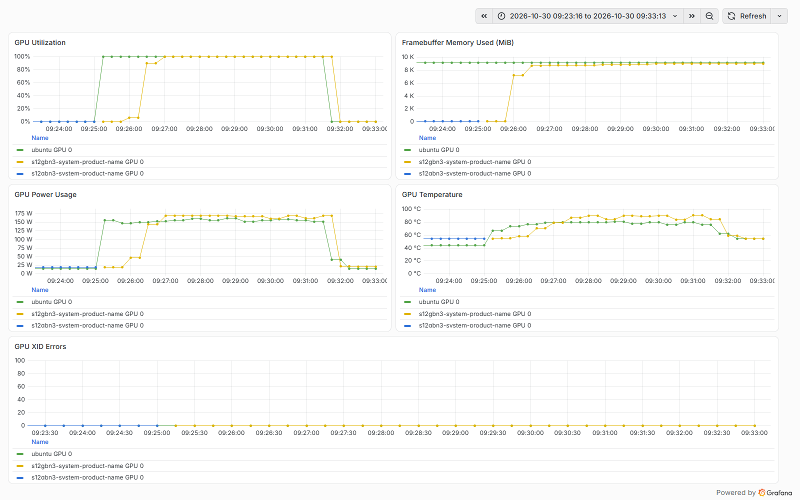
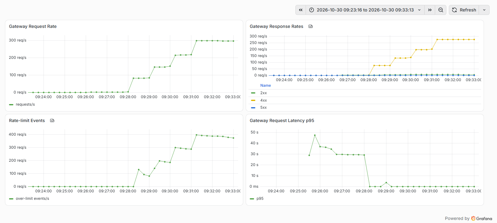

# Báo cáo: Nền tảng phục vụ LLM trên GPU có autoscale

Cập nhật: 30/10/2026

## 1. Kết quả chính

- Llama-3.1-8B-Instruct chạy trên cụm k3s 2 node, mỗi node một RTX 3060 12 GB, qua KServe + vLLM.
- Người dùng gọi API kiểu OpenAI hoặc chat trên Open WebUI. Mọi request đi qua Envoy AI Gateway: kiểm tra API key, giới hạn 100k token/phút cho mỗi key.
- Prometheus thu metric của vLLM, GPU (DCGM) và gateway; Grafana có 4 dashboard; Alertmanager có rule cảnh báo.
- KEDA tự scale vLLM giữa 1 và 2 replica theo số request đang xử lý. Kiểm thử với 30 request đồng thời: lên 2 replica sau 15 s, pod mới phục vụ sau 1 phút 33 s, tải chia 50/50, về 1 replica sau khoảng 10 phút hết tải, 1.871/1.871 request thành công.

## 2. Kiến trúc

| Lớp | Thành phần | Phiên bản |
|---|---|---|
| Cụm | k3s (1 control-plane + 1 worker), NVIDIA Container Toolkit, GPU Operator | k3s v1.36.5, CTK 1.20.1, GPU Operator v26.7.2 |
| Serving | KServe (Standard mode), ClusterServingRuntime vLLM | KServe v0.21.0, vLLM v0.31.0 |
| Model | Llama-3.1-8B-Instruct AWQ INT4, chép sẵn vào `/opt/models/llama31-8b` trên mỗi node | `hugging-quants/...-AWQ-INT4@db1f81a` |
| Gateway | Envoy Gateway + Envoy AI Gateway, Redis cho rate limit | EG v1.8.1, AI Gateway v1.1.0 |
| Truy cập ngoài | Cloudflare quick tunnel (1 cho API, 1 cho Open WebUI) | cloudflared 2026.10.2 |
| Giao diện | Open WebUI | v0.12.3 |
| Observability | kube-prometheus-stack, Loki, Alloy | |
| Autoscale | KEDA, ScaledObject + HPA | KEDA 2.21.0 |

### Phần cứng

| Node | Vai trò | CPU / RAM | GPU | Ổ đĩa |
|---|---|---|---|---|
| `s12gbn3-system-product-name` (192.168.1.147) | control-plane + GPU | i7-12700 / 31 GB | RTX 3060 12 GB, driver 595.99 | 457 GB, đang dùng ~83% |
| `ubuntu` (192.168.1.129) | worker GPU | i5-12400F / 31 GB | RTX 3060 12 GB, driver 595.91 | 233 GB, dùng 40% |

Hai máy cùng LAN; k3s nói chuyện qua LAN, Tailscale chỉ dùng để quản trị từ xa. Máy server dùng chung với chủ máy (có LiteLLM, Docker, giao diện đồ hoạ).

## 3. Đã làm theo từng phần

### 3.1. Cụm và GPU

- Script `infra/node/prepare-gpu-node.sh` (cài toolkit, kiểm tra driver và dung lượng đĩa) và `install-k3s.sh` (có thêm chế độ agent để join node thứ 2).
- containerd của k3s dùng `nvidia` làm runtime mặc định, pod GPU không cần `runtimeClassName`.
- GPU Operator chỉ bật device plugin, GPU feature discovery và dcgm-exporter; driver và toolkit cài sẵn trên host.
- Giữ cố định gói kernel và module NVIDIA bằng `apt-mark hold` trên máy server, sau sự cố driver ở mục 5.

### 3.2. Model và serving

- Phiên bản đầu chạy trên VM RTX 4090 24 GB với bản BF16, model tải bằng Job vào PVC `local-path`. Khi chuyển sang RTX 3060 thì BF16 (15 GB) không vừa, đổi sang AWQ INT4 (5,4 GB). vLLM tự nhận AWQ và dùng kernel Marlin.
- PVC `local-path` chỉ gắn được vào một node, nên khi có 2 node, model được chép sẵn vào cùng đường dẫn trên mỗi node và mount `hostPath` chỉ đọc (`docs/runbooks/model-on-nodes.md`). Node có model mới được gắn nhãn `llm-serving/model-llama31-8b=true`.
- Tham số vLLM: `max-model-len 16384`, `gpu-memory-utilization 0.80` (chừa VRAM cho giao diện đồ hoạ trên máy server), tool calling cho Open WebUI (`llama3_json`).
- KV cache mỗi replica: 18.400 token, đủ một request 16K.
- Vòng đời pod: startup probe tối đa 10 phút, `preStop` 15 s, `--shutdown-timeout=90`, `terminationGracePeriodSeconds 120`, nên tắt pod không làm đứt request đang stream.
- RollingUpdate `maxSurge 0, maxUnavailable 1` (không có GPU thứ 3) và PDB `minAvailable 1`.

### 3.3. Gateway

- `AIGatewayRoute` đọc trường `model` trong body để định tuyến, timeout 300 s.
- API key mỗi người một key, lưu trong Secret, quản lý bằng `serving/gateway/api-key.sh add|revoke|list`. Không cần restart khi thêm hay thu hồi.
- Rate limit theo token thật lấy từ `usage` của response, đếm trong Redis: 100k token/phút cho mỗi key.
- Gateway tự gắn key nội bộ khi gọi vLLM; client không biết key này.
- `ClientTrafficPolicy` nâng giới hạn body lên 4 MiB (mặc định ~32 KiB làm Open WebUI bị 413).
- Access log JSON ghi client, model, mã trạng thái, thời gian và số token; không ghi body hay key.

### 3.4. Open WebUI

- Dùng chung một key gateway. Admin được tạo trước khi mở URL công khai; sau đó Open WebUI tự tắt đăng ký, admin tạo tài khoản cho từng người.
- Phải tắt Builtin Tools: mỗi tin nhắn tốn thêm khoảng 8.000 token.

### 3.5. Observability

- Prometheus scrape 15 s, giữ 7 ngày. PodMonitor cho vLLM và Envoy, ServiceMonitor cho DCGM và các thành phần gateway.
- Recording rule: `llm_serving:vllm_concurrency:sum` (running + waiting), TTFT p50/p95, inter-token latency p95, tok/s, request và lỗi tại gateway.
- Alert: vLLM down, lỗi XID của GPU, TTFT cao, KV cache gần đầy, tỉ lệ 5xx, pod restart liên tục.
- 4 dashboard (GPU, Serving, Gateway, Autoscaling) lưu JSON trong git, nạp vào Grafana qua ConfigMap. Grafana chỉ truy cập qua `kubectl port-forward` và SSH tunnel.
- Metric GPU thu được trên RTX 3060: 16 metric DCGM cơ bản (util, VRAM, công suất, nhiệt độ, clock, XID...). Nhóm `DCGM_FI_PROF_*` (tensor, DRAM active) không có trên dòng GeForce.

### 3.6. Autoscale

- KServe đặt `autoscalerClass: external` để không tạo HPA riêng; KEDA sinh HPA duy nhất trỏ vào Deployment `llama31-8b-predictor`.
- Hai trigger, HPA lấy giá trị lớn hơn:

| Trigger | Metric | Ngưỡng |
|---|---|---|
| `concurrency` | running + waiting, chia trung bình mỗi replica | 4 |
| `kvcache` | trung bình `vllm:kv_cache_usage_perc` | 0,8 |

- Lên ngay, thêm tối đa 1 pod/phút. Xuống sau 600 s không cần đến. Mất metric 3 lần liên tiếp thì giữ 2 replica.
- Không dùng `GPU_UTIL` hay `FB_USED`: `GPU_UTIL` lên gần 100% với 1 request vì mỗi bước decode đọc toàn bộ weights, còn `FB_USED` luôn cao vì vLLM giữ trước VRAM. Scale theo hai metric này thì có 1 người dùng đã lên 2 replica và không bao giờ xuống. Trên 3060, metric GPU duy nhất có tương quan với tải là công suất (`POWER_USAGE`); chưa đưa vào trigger.

## 4. Số liệu đo

### 4.1. vLLM so với Transformers (RTX 4090, BF16, 256 token ra)

| | TTFT | Thời gian 1 request | Throughput |
|---|---|---|---|
| vLLM, 1 request | 0,036 s | 4,29 s | 60 tok/s |
| Transformers `generate()`, 1 request | 0,034 s | 7,60 s | 34 tok/s |
| vLLM, 8 request song song | | 4,4 s cho cả 8 | 463 tok/s |
| Transformers, 8 request song song | TTFT tối đa 55 s | 63 s cho cả 8 | 33 tok/s |

Chênh lệch chính nằm ở batching: vLLM gộp 8 request vào cùng một bước decode, Transformers xử lý tuần tự.

### 4.2. Sức chứa 1 replica (RTX 3060, AWQ, 512 token vào / 256 token ra, gọi thẳng vLLM)

| Request song song | TTFT p95 | Throughput | KV cache max |
|---|---|---|---|
| 2 | 0,05 s | 121 tok/s | 0,08 |
| 4 | 1,25 s | 181 tok/s | 0,17 |
| 5 | 1,56 s | 212 tok/s | 0,20 |
| 6 | 1,86 s | 242 tok/s | 0,25 |
| 7 | 2,16 s | 268 tok/s | 0,29 |
| 8 | 2,18 s | 283 tok/s | 0,33 |
| 16 | 3,90 s | 381 tok/s | 0,67 |

Với SLO TTFT p95 ≤ 2 s, một replica giữ được 6 request song song. Ngưỡng scale đặt 4 (0,75 × 6, làm tròn xuống) để còn dư trong khoảng 1,5 phút chờ pod mới. Ban đầu SLO là 1 s, ngưỡng 2; nới lên 2 s ngày 28/10 vì với 1 s chỉ vài người dùng đã phải bật GPU thứ 2.

## 5. Thực nghiệm khác: 100 request đồng thời

### 5.1. Cách làm

- Ngày 30/10, 09:24:46–09:31:13. Bắt đầu từ 1 replica (node `ubuntu`).
- 100 luồng chạy trên node server, mỗi luồng gửi liên tục `POST /v1/chat/completions` qua gateway, prompt ngắn (~20 token), `max_tokens 256`, mỗi request một kết nối mới. Tất cả dùng chung một API key.
- Ảnh chụp từ Grafana, khung thời gian 09:23:16–09:33:13.

### 5.2. Kết quả

| Chỉ số | Giá trị |
|---|---|
| Request thành công (200) | 2.373 |
| Bị rate limit (429) | 82.900 |
| Lỗi kết nối phía client (curl `000`) | 10.029 |
| KEDA quyết định lên 2 replica | 09:25:02, 16 s sau khi có tải |
| Pod thứ 2 Ready | ~09:26:15, khoảng 1 phút 30 s sau quyết định scale |
| Throughput sinh token đỉnh | ~1.600 tok/s (2 replica) |
| TTFT p95 | ~4,6 s khi 1 replica; giảm dần còn ~1,5 s sau khi có 2 replica và tải giảm |

Con số 429 và lỗi kết nối không phải lỗi của hệ thống mà do cách bắn tải:

- 2 replica sinh ~1.600 tok/s, tức ~96k token đầu ra mỗi phút, cộng token đầu vào thì vượt hạn mức 100k token/phút của một key. Từ 09:27:57 gateway bắt đầu trả 429, đúng như cấu hình.
- Vòng lặp tải không có backoff: nhận 429 là gửi lại ngay, nên số request bị chặn lên tới ~300 req/s. Lỗi `000` xuất hiện cùng lúc, nhiều khả năng do hết cổng TCP tạm phía máy bắn tải (mỗi request mở một kết nối mới); chưa kiểm chứng.

Để đo sức chứa thật cần chia tải cho nhiều key hoặc dùng key có hạn mức riêng cho load test.

### 5.3. Autoscaling Overview

- Concurrency lên ~100 ngay khi bắt đầu. Pod `6kxm7` (node `ubuntu`) một mình chạy 95–100 request, KV cache chạm 99% và có tới 20 request phải chờ.
- Pod `9qtps` (node server) Ready lúc ~09:26:15 nhưng nhận tải chậm: 3 phút đầu chỉ 5–30 request, trong khi pod cũ vẫn 70–90. Đến ~09:29 hai pod mới cân bằng (~50 mỗi bên). Lý do: các kết nối Envoy → vLLM đang phục vụ request dài thì không đóng, nên chỉ khi chúng kết thúc thì kết nối mới mới có cơ hội rơi vào pod mới. Ở tải 4 hoặc 30 request, hiện tượng này gần như không thấy.
- Sau khi có pod thứ 2, không còn request phải chờ.

### 5.4. LLM Serving Overview

- TTFT p95 tăng lên ~4,6 s trong lúc chỉ có 1 replica, vượt SLO 2 s. Đây là khoảng trống khi chờ pod mới (~1,5 phút) cộng thời gian pod mới bắt đầu nhận tải.
- Inter-token latency p95 lên ~120 ms khi 100 request cùng decode trên 1 GPU, về ~75 ms khi tải chia ra.
- Throughput tăng dần tới ~1.600 tok/s. Đường này là trung bình trượt 5 phút nên tăng chậm hơn thực tế.

### 5.5. GPU Overview

- `GPU_UTIL` lên 100% ngay khi có tải và giữ nguyên dù số request trên mỗi GPU thay đổi từ 30 tới 100. Đây là lý do không dùng metric này để scale.
- Công suất 150–170 W mỗi GPU khi có tải, ~15–20 W khi rảnh.
- Nhiệt độ GPU node server lên ~88 °C, node `ubuntu` ~80 °C.
- VRAM ~9 GB mỗi GPU, không đổi theo tải vì vLLM cấp phát trước.
- Không có lỗi XID.

### 5.6. Gateway Overview

- Trước 09:28 gần như toàn bộ request là 2xx, nhưng số request/giây thấp vì mỗi request mất vài chục giây (p95 30–47 s, chủ yếu là thời gian sinh 256 token khi GPU bận).
- Từ 09:28, 4xx (429) và rate-limit events tăng dần tới ~300–400/s, cho thấy rate limit theo token hoạt động. Độ trễ p95 tụt về gần 0 vì phần lớn request bị chặn ngay tại gateway.
- Không có 5xx.

## 6. Tài liệu liên quan

- Triển khai từ đầu: `docs/runbooks/deploy-from-scratch.md`
- Model trên nhiều node: `docs/runbooks/model-on-nodes.md`
- Gateway: `docs/runbooks/gateway.md`, `docs/specs/gateway.md`
- Observability: `docs/runbooks/observability.md`, `docs/specs/observability.md`
- Autoscale: `docs/runbooks/autoscaling.md`, `docs/adr/0002-autoscaling.md`
- Kết quả đo: `loadtest/results/`
