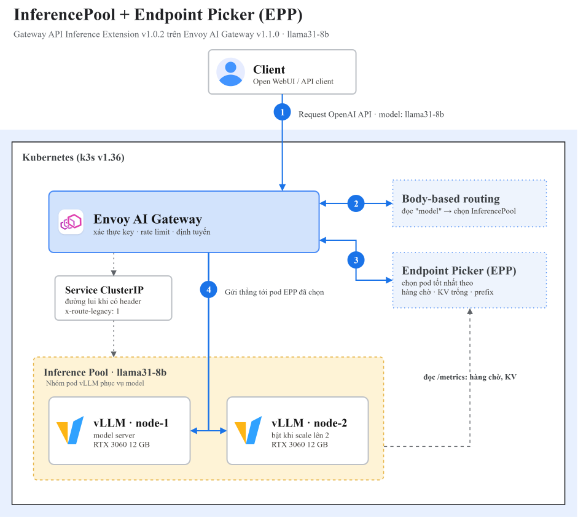

# GPU LLM Serving with Autoscaling

Self-host Llama 3.1 8B (AWQ-INT4) trên cụm k3s 2 node, mỗi node một RTX 3060 12 GB. Request đi qua Envoy AI Gateway, được EPP chọn pod theo tải thực tế của vLLM, và KEDA tự scale từ 1 lên 2 replica khi tải tăng.


## Cụm

| | node-1 | node-2 |
|---|---|---|
| Vai trò | control-plane + GPU worker | GPU worker |
| GPU | RTX 3060 12 GB | RTX 3060 12 GB |
| Chạy thêm | Registry, Prometheus, Grafana, Loki | |

- k3s v1.36, containerd 2.3, mạng 1 GbE.
- NVIDIA GPU Operator cài driver toolkit, device plugin và DCGM Exporter.
- Mỗi node chỉ có 1 GPU, nên tối đa 1 pod vLLM mỗi node.

## Luồng request

1. Người dùng chat qua **Open WebUI**, hoặc gọi thẳng OpenAI API bằng SDK/curl với API key riêng.
2. **Cloudflare Tunnel** đưa traffic vào cụm. Có 2 quick tunnel, một cho web UI và một cho API. Không mở cổng nào trên node.
3. **Envoy AI Gateway** kiểm API key, gắn `x-client-id`, trừ rate limit theo token (Redis), đọc trường `model` trong body để chọn route.
4. Envoy hỏi **EPP** nên gửi tới pod nào, rồi gửi thẳng tới pod vLLM đó.
5. **vLLM** sinh token và stream kết quả ngược lại qua gateway.

## Thành phần

### Ingress & UI

- **Cloudflare Tunnel** (`platform/cloudflared`, `serving/open-webui/tunnel.yaml`): expose web UI và API ra internet mà không cần IP public.
- **Open WebUI** (`serving/open-webui`): giao diện chat, dùng chung một API key để gọi gateway.

### Gateway & routing

- **Envoy Gateway 1.8.1 + AI Gateway 1.1.0** (`serving/gateway`)
  - `SecurityPolicy`: xác thực API key, map key sang `x-client-id`.
  - `AIGatewayRoute`: route theo model, gắn key nội bộ khi gọi xuống backend.
  - Access log đẩy sang Loki.
- **Redis** (`platform/redis`): lưu bộ đếm rate limit, 100k token/phút cho mỗi key. AI Gateway đếm token thật từ response.
- **Đường lui**: request có header `x-route-legacy: 1` bỏ qua EPP, đi qua Service ClusterIP (kube-proxy chia round-robin). Dùng để so sánh A/B.

### InferencePool + EPP



Hai thứ này đi cùng nhau, thuộc Gateway API Inference Extension v1.0.2 (`serving/inference-pool`).

- **InferencePool** là CRD khai báo nhóm pod vLLM: selector, cổng 8000, và EPP nào phụ trách chọn pod. Pod mới tự vào pool khi Ready, và rời pool trước khi tắt.
- **EPP (Endpoint Picker)** là một Deployment. Nó liên tục đọc `/metrics` của từng pod vLLM (hàng chờ, KV cache), rồi trả lời Envoy qua gRPC ext-proc (`:9002`) pod nào tốt nhất. Các tiêu chí chấm điểm:
  - ít request đang chờ,
  - còn nhiều KV cache trống,
  - prefix đã có sẵn trong cache.

EPP không chuyển tiếp request, nó chỉ chọn pod. Envoy mới là bên gửi request tới pod.

vLLM v0.31 đổi tên metric KV cache, nên `epp.yaml` phải truyền thêm `--kv-cache-usage-percentage-metric`.

### Serving

- **KServe v0.21** (`serving/kserve`), InferenceService `llama31-8b` ở Standard mode. `autoscalerClass: external` để KEDA lo phần scale.
- **vLLM v0.31** (`serving/kserve/runtimes/vllm.yaml`)
  - `max-model-len` 16384, `gpu-memory-utilization` 0.80.
  - Bật tool calling (`llama3_json`).
  - Cache compile (torch.compile, CUDA graph) để trên hostPath `/opt/vllm-cache` của mỗi node. Pod khởi động lại không phải compile lại.
- **Vòng đời pod**
  - RollingUpdate `maxSurge: 0`, vì không còn GPU trống để chạy thêm pod mới song song.
  - PDB `minAvailable: 1` (`autoscaling/pdb`).
  - `preStop` 15 s, vLLM `--shutdown-timeout=90` để request đang chạy được xử lý xong.
  - Probe `/health` mỗi 2–3 s.

### Model storage (OCI image)

Model được đóng gói thành OCI image, rồi mount vào pod bằng Kubernetes Image Volume.

1. **`serving/models/package-model.sh`**: kiểm `SHA256SUMS`, build image `busybox` + `/models`, push lên registry và in ra digest.
2. **Registry** (`platform/registry`): `registry:3.1.2` chạy trên node-1, NodePort `30500`, xác thực bằng htpasswd, dữ liệu trên PVC.
3. **containerd** mỗi node đọc thông tin đăng nhập từ `/etc/rancher/k3s/registries.yaml`, và bật `discard_unpacked_layers` để không giữ thêm bản nén (`infra/node`).
4. **InferenceService** mount image vào `/models` (`subPath: models`, read-only).
5. **Pre-pull DaemonSet** (`prepull.yaml`) giữ sẵn image trên mọi node GPU, để lúc scale lên không phải chờ kéo vài GB.

Digest chỉ khai báo một chỗ, trong InferenceService. Kustomize `replacements` copy sang DaemonSet, còn Job loadtest đọc từ cluster.

### Autoscaling

- **KEDA 2.21** ScaledObject (`autoscaling/scaledobjects`) query Prometheus mỗi 15 s, với 2 trigger:
  - concurrency trung bình mỗi replica > 6,
  - hoặc KV cache GPU > 0.8.
- Khi Prometheus lỗi, KEDA giữ 2 replica (fallback).
- **HPA** do KEDA tạo:
  - Scale lên ngay, mỗi lần 1 pod/60 s.
  - Scale xuống sau 600 s ổn định.
  - min 1, max 2.

### Observability

- **kube-prometheus-stack** (`platform/kube-prometheus-stack`, `observability/`)
  - Scrape vLLM, Envoy, các controller của gateway và DCGM mỗi 15 s.
  - Recording rule `llm_serving:*` và `llm_gateway:*` dùng chung cho dashboard, alert và KEDA.
- **DCGM Exporter**: nhiệt độ, clock, công suất GPU.
- **Grafana**: 4 dashboard (serving, gateway, GPU, autoscaling).
- **Alerting**: 6 alert, ví dụ `VLLMDown`, `HighTTFT`, `KVCacheNearFull`, `GPUXidError`.
- **Loki + Alloy**: log của pod và access log của gateway.

### Loadtest

- **inference-perf** (`loadtest/inference-perf`): Job chạy trong cụm, gọi qua gateway bằng key loadtest. Tokenizer lấy luôn từ image model.
- **`loadtest/scenarios`**
  - `bench.sh` chạy `vllm bench serve` trong pod để đo sức chứa 1 replica.
  - `run-scenario.sh` + `loadgen.py` chạy các kịch bản tải S1–S6, `watch.sh` ghi timeline replica và metric.
- **`loadtest/compare`**: script tổng hợp kết quả (`capacity_report`, `ip_report`).

## Số liệu

- [Sức chứa 1 replica, cold start](serving/kserve/README.md)
- [EPP so với ClusterIP](serving/inference-pool/README.md)
- [Autoscaling S1–S6](autoscaling/README.md)
- [Model storage](serving/models/README.md)

## Cấu trúc repo

```
infra/node/        cài k3s, chuẩn bị node GPU, cấu hình containerd
platform/          Helm values và manifest cho các thành phần nền
serving/           gateway, InferencePool + EPP, KServe, model, Open WebUI, smoke test
autoscaling/       KEDA ScaledObject, PDB
observability/     PodMonitor, ServiceMonitor, recording rule, alert, dashboard
loadtest/          inference-perf, kịch bản tải, script báo cáo
```
